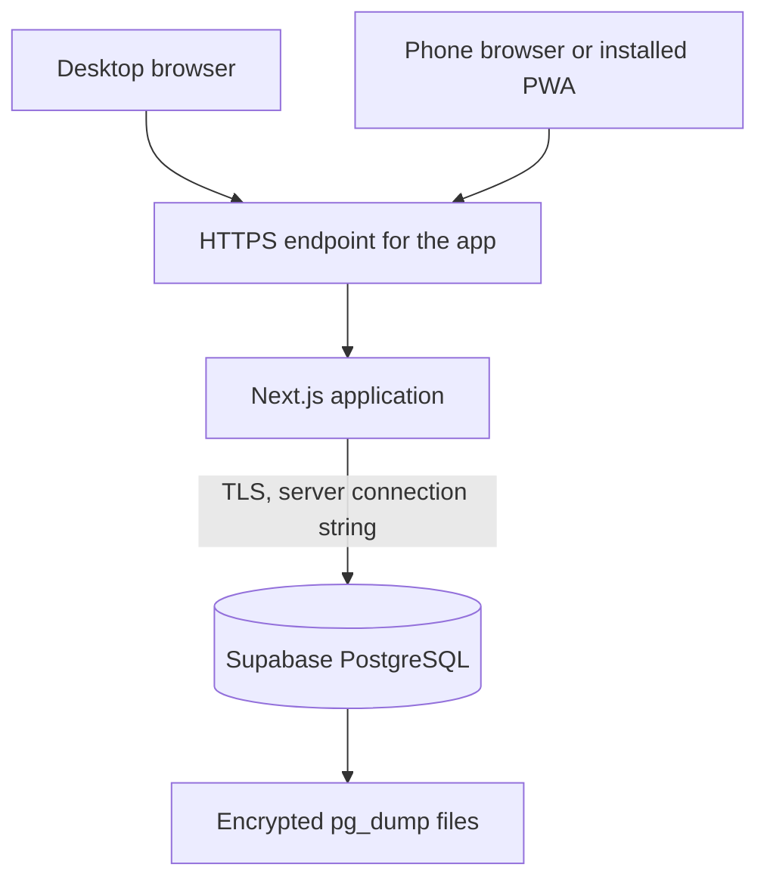
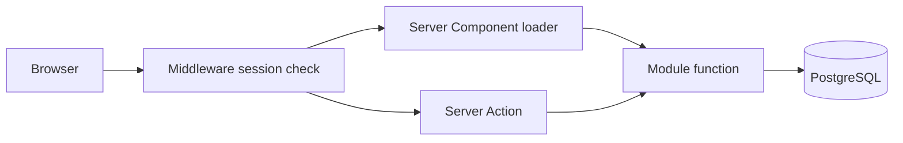

# Technical architecture

Status: planning decision, 27 October 2026. Implementation has not started.

This document is the source of truth for stack, process boundaries, and security controls. Product behavior is defined in [01-product-requirements.md](./01-product-requirements.md). The schema is defined in [03-data-model.md](./03-data-model.md).

## 1. Recommendation in one page

Build a modular monolith:

- One Next.js application, App Router, TypeScript, pinned to the current Next.js 16 stable line. On 27 October 2026 that stable release is 16.4.3. The 16.5 line was canary-only. Re-check the patch release at scaffold time and take the latest 16.4 security patch.
- React Server Components read the database. Server Actions mutate it. Route handlers exist only for session endpoints, health, and file download.
- PostgreSQL hosted by Supabase. Drizzle ORM 0.45.x talks to it with a server-side connection string. On 27 October 2026 the stable Drizzle release is 0.45.4. Do not adopt the 1.0 release candidate; its timestamp and JSON changes would become a migration of their own.
- Custom database sessions and Argon2id passwords. One seeded owner. No public registration. Supabase Auth is not used.
- Tailwind CSS and an accessible component set generated into the repo (shadcn/ui style). Server Actions and Zod for forms. No global client state library.
- The Next.js process is the only application server. It reaches Supabase over TLS. Backups are Supabase's managed backups plus an encrypted `pg_dump` kept outside Supabase.
- Online-only data. The PWA caches the static shell and an offline page that holds no personal data.

Node 24 is the Active LTS on 27 October 2026 (24.22.1 was the latest LTS patch published 21 October 2026). The local machine has Node v23.9.0, which is end of life. The project engine and the Docker image use Node 24. Node 26 becomes LTS on 28 October 2026; leave it until it has had a quiet period.

## 2. System context



The browser never holds a database credential, a Supabase anon key, or a service-role key. The phone and the desktop do not sync with each other. They both talk to the application, and the application talks to one Supabase PostgreSQL project.

### 2.1 How this becomes the phone app

There is one application. The phone does not get a second codebase, a second database, or a copy of the rows.

Next.js renders the screens on the server. A phone browser and a desktop browser request those same screens. Layouts at a narrow width use the bottom navigation in the UX document. The installed phone app is that site, added to the home screen:

1. The site is served over HTTPS.
2. A web app manifest names the app, sets the icon, and asks for a standalone window so the browser address bar stays hidden.
3. On Android, Chrome offers "Install app". On iPhone, the owner uses Share, then Add to Home Screen. iOS does not list this kind of app in the App Store.
4. Opening the icon loads the live site. Sign-in uses the same account as the desktop. Supabase is still reached only by the server.

The data stays on the server because the screens are rendered there and the writes are server actions. An installed icon cannot carry the database inside the phone. When the network is missing, the icon opens the offline page, which has no personal records.

A store binary is a later choice, and only if the home-screen app blocks a real need. The wrapper that fits this architecture is a thin native shell, such as Capacitor, whose web view loads the hosted site. The tasks, habits, and login code stay in Next.js. A React Native or Swift app would be a second interface over the same server, which this plan does not build.

Push notifications are not part of that install step. iOS delivers web push only to a home-screen app, and delivery is still uneven. The reliable reminder remains My Day when the app is opened.

There is no queue, no separate worker, no search cluster, and no object store. Markdown and numbers live in PostgreSQL. Exports are generated in the request that downloads them.

## 3. Why this shape

The product is a single-owner, relational, privacy-sensitive system of record. The hard parts are correct dates, idempotent recurrence, authorization, and backups. They are not fan-out, multi-tenant scale, or realtime collaboration.

A modular monolith keeps one transaction boundary. Completing a task and writing its activity row commit together. Promoting a plan action and creating a task commit together. A network of services would add failure modes the product does not need.

Two native applications, or a separate API plus a single-page app, would duplicate the screens before the daily loop is even real. A later native client can be introduced in front of route handlers extracted from the same modules. That extraction is not justified now.

## 4. Decision records

### 4.1 Application framework

Recommendation: Next.js 16 App Router with TypeScript.

Why it fits: the product is a server-rendered, form-heavy, authenticated web app that must also feel direct on a phone. One project can render My Day on the server, accept a completion, and re-render from the database. The same deployment serves the desktop layout and the installed phone shell.

Alternatives:

| Option | What it would give | Why it lost |
| --- | --- | --- |
| Django plus server-rendered templates | Strong auth, admin, and migrations in Python | The comparison matrix, charts, and phone navigation would fight the template model, or a second React app would appear anyway |
| FastAPI plus a Vite SPA | A clean HTTP API from day one | Two deployables, a client data cache, and an auth design, before the first trustworthy task list |
| Nuxt | A similar full-stack result in Vue | No meaningful reduction in complexity for this product, and a smaller set of accessible building blocks ready to vendor into the repo |

Trade-off: Next.js caching can accidentally serve one user's page to another, or serve a stale authenticated page, if a route is made static. Mitigation is a project rule, not a hope: the authenticated layout is dynamic, user data is never stored in the shared data cache, and tests request private pages without a cookie.

Maintenance: stay on the Next.js 16 stable line and apply security patches. Do not track canary. The October 2026 security releases are a reason to pin a patched 16.4.x, not a reason to leave the framework.

### 4.2 Process and API style

Recommendation: Server Components for reads, Server Actions for mutations, and route handlers for login cookie plumbing, `GET /health`, and export downloads.

Why it fits: there is one client and it is this application. A public JSON API would be a second contract to authorize and version. Server Actions run in the same process as the queries and can share a transaction helper.

Rules:

- Every action and every private loader calls `requireUser()` and then queries with that user id. Middleware is an extra gate, not the gate.
- Inputs are parsed with Zod before they touch the database.
- Actions return a small result object the form can show. They do not redirect away from a failed save and lose the typed text.
- A route handler is added only when the caller is not a form: health checks, the export file, and the session callback if the auth design needs it.

Alternatives: tRPC, REST, or GraphQL. Each is a reasonable way to serve a second client. None of them removes work from the MVP, and all of them add a place to forget an ownership check.

Trade-off: Server Actions are easy to call from a modified browser. That is acceptable only because authorization lives inside the action. The team does not disable Next.js origin checks.

### 4.3 Database

Recommendation: PostgreSQL on Supabase, used only as the database. The owner chose this on 27 October 2026 in place of a Postgres container.

Why it fits: the schema needs real dates, instants with time zones, numeric values that are not binary floats, unique partial indexes, and transactions. Supabase provides that Postgres, TLS, and managed backups, without a database container to operate. Personal write volume is tiny. The application keeps its own SQL, its own sessions, and its own authorization.

What is in use from Supabase:

- One Supabase project. The owner chose a single instance on 27 October 2026 because this is a private app. Real records and the running app share that database.
- The Postgres connection strings from that project's Connect panel.
- Managed backups on whatever plan that project is on.
- A separate Postgres schema, `app_test`, inside the same database, used only by automated tests. Tests create, migrate, and truncate `app_test`. They never truncate `public`, which is where the owner's records live. A restore drill uses another scratch schema, `restore_drill`, and drops it afterward.

What is not in use:

- Supabase Auth, the client Data API, Realtime, Storage, and the service-role key. Adding any of them would create a second way into the same private rows.
- The anon key. It is never placed in the browser or in the Next.js server env.

Connection rules, from Supabase's connection guide:

- `DATABASE_URL` is the runtime URL. Prefer the session-mode pooler (port 5432 on the pooler host). It works from a normal IPv4 network and supports prepared statements. A direct connection is also fine when the host has IPv6 or the project's IPv4 add-on.
- `DIRECT_URL` is the direct connection (port 5432 on `db.<project-ref>.supabase.co`) for Drizzle migrations and `pg_dump`. Direct connections are IPv6 unless the IPv4 add-on is enabled. If direct is unreachable, migrations use the session-mode pooler URL instead. They do not use transaction mode.
- Transaction mode (port 6543) is for short-lived serverless workers. This app is one long-running Node process, so it does not use transaction mode. If a later host is serverless, the runtime URL switches to transaction mode and the postgres.js client sets `prepare: false`. Migrations still avoid transaction mode.
- Every URL includes `sslmode=require`.
- The server pool stays small, on the order of five connections. One person does not need more, and a small Supabase instance has a low connection ceiling.

The Data API is turned off in the project's API settings, which Supabase documents as the right step when Drizzle is the only client. Row Level Security is still enabled on every application table, with no policies for `anon` or `authenticated`. The migration role owns the tables and reaches them through the connection string. A later accidental switch-on of the Data API then denies anonymous access instead of exposing finances and notes. `FORCE ROW LEVEL SECURITY` is not set, because that would also block the owner role the app uses.

Alternatives:

| Option | What it would give | Why it is not the current choice |
| --- | --- | --- |
| PostgreSQL 17 in Docker beside the app | The database stays on a machine the owner controls, and a backup is a volume plus a dump | The owner asked for Supabase instead. The container is no longer part of the plan |
| SQLite in the application process | One file to copy | Date and numeric types are looser than the schema requires |
| Supabase Auth and the Data API from the browser | Less server code | The browser would hold a key, and private tables would need a second authorization policy. The app already has sessions and `user_id` checks |

Trade-off: Supabase operates the disk. Faith, health, and finance rows are readable by that operator in the same way any hosted database is. The owner accepted that by choosing Supabase. The compensating controls are TLS, server-only credentials, a disabled Data API, default-deny RLS, application ownership checks, and a dump that does not live only inside Supabase.

A free Supabase project can be paused after about a week with too little database activity, and it stays unavailable until someone restores it in the dashboard. Paid projects are not paused for inactivity. This single project should be on a paid plan if a week away must not take My Day offline. Confirm the plan terms on the day the project is created.

Maintenance: Supabase chooses the Postgres minor version. Major upgrades are their maintenance window plus a dump taken beforehand. The schema does not pin a Docker image tag.

### 4.4 Database access

Recommendation: Drizzle ORM 0.45 with the `postgres` driver (postgres.js), and SQL migrations generated by Drizzle Kit and committed under `drizzle/`.

Why it fits: dashboard, review, and recurrence queries need explicit SQL. Drizzle keeps that SQL visible and typed. The stable 0.45 line is a small dependency and matches the "no release candidate in the core path" rule.

Alternatives:

| Option | What it would give | Why it lost |
| --- | --- | --- |
| Prisma | Fast CRUD and a familiar schema file | The queries that matter here are aggregations and idempotent inserts. Prisma's client hides the SQL and has been more awkward for partial unique indexes |
| Drizzle 1.0 RC | The next API | Pre-release, with breaking parser changes around timestamps and JSON. Revisit after a stable 1.0 and a date-focused test suite |
| Hand-written SQL only | Full control | More boilerplate for ordinary inserts. Drizzle still allows SQL where a query is sharper that way |

Trade-off: Drizzle returns PostgreSQL `numeric` as strings. Money, distances, and durations stay strings or scaled integers in TypeScript until the display layer formats them. JavaScript `number` is not used for stored measurements.

Maintenance: forward-only migrations. Drizzle Kit applies them through `DIRECT_URL`, or through the session-mode pooler when the direct host is unreachable. The app process may apply any still-pending migrations before it listens. There are no down migrations; recovery is a backup restore. Expand a column, deploy, then contract an old column in a later migration when a change would otherwise break a running process. Generated migrations must not `GRANT` application tables to `anon` or `authenticated`.

### 4.5 Validation and types

Recommendation: TypeScript strict mode, Zod schemas beside each module, and Drizzle types for query results.

One Zod schema validates a form and the server action. Domain functions that compute recurrence dates, habit outcomes, and net worth accept plain values and do not import React. Those functions are the unit-test surface.

### 4.6 Authentication and session

Recommendation: a small custom session module.

- The owner row is created by a seed command. There is no signup action.
- Passwords are hashed with Argon2id (`@node-rs/argon2`).
- Login compares the hash, then creates a session row. The cookie contains a random token. The database stores only its SHA-256 hash.
- Cookie name `__Host-session`. Flags: `HttpOnly`, `Secure`, `SameSite=Lax`, `Path=/`. The `__Host-` prefix requires Secure, Path `/`, and no Domain attribute.
- Sessions last 30 days. Each successful authenticated request may slide `last_seen_at`. Expiry is enforced in `requireUser()`.
- Logout deletes the session row.
- Login failures are recorded. Five failures for the same email inside 15 minutes return the same generic error and do not attempt another password check.
- Password change re-hashes the password and deletes the other sessions.

Why it fits: the product needs exactly login, logout, expiry, and revocation for one account. That is small enough to read in one file and test directly.

Alternatives:

| Option | What it would give | Why it lost |
| --- | --- | --- |
| Auth.js Credentials | A known integration with Next.js | The project still documents v5 as beta. The Credentials provider also does not persist sessions unless extra code is written, which removes the reason to take the dependency |
| Better Auth 1.7 | A stable TypeScript auth library with a Drizzle adapter, email and password, and optional TOTP | Real and actively maintained (1.7.14 on 26 October 2026). It also pulls a plugin platform the MVP will not use, and it ships very often. Prefer it later if the owner wants passkeys or TOTP without writing them |
| HTTP basic auth in the reverse proxy | Very little application code | No in-app password change, awkward PWA behavior, and a second auth story that is easy to bypass if a port is published by mistake |

Trade-off: the application owns cookie security. The mitigation is a short checklist in the testing document and tests that a missing, expired, or revoked cookie cannot load or mutate data. If TOTP becomes required, adopt Better Auth in a dedicated phase instead of growing a home-built factor.

Middleware redirects anonymous page loads to `/login`, except `/login`, `/offline`, `/health`, and static assets. It is not sufficient. Loaders and actions call `requireUser()` again because middleware has been the wrong place to enforce security in this framework more than once. `/health` and `/offline` do not call `requireUser()`.

### 4.7 Authorization

There is one role: the owner. Authorization is row ownership.

- Every `SELECT`, `UPDATE`, and `DELETE` includes `user_id = current user`, or joins through a parent that is checked the same way.
- Identifiers that arrive from the client are not trusted. A task id from another user returns not found, the same as a missing id.
- Life areas are global reference rows. Linking one is allowed. Editing the catalog is not an application feature.
- Integration tests create two users and prove the second user cannot read or change the first user's task, habit log, metric, plan, or review.

### 4.8 User interface composition

Recommendation: Tailwind CSS, with accessible primitives copied into `src/components/ui` from the shadcn/ui pattern. Icons from a single icon set.

Why it fits: the screens are forms, lists, and a few charts. Owning the component source avoids a styling framework we cannot debug. The visual language stays plain: readable type, clear groups, and enough contrast. The UX document describes structure, not a brand system.

Alternative: a heavier component library such as MUI. It is faster for dense admin grids and slower to make a calm phone UI. This product is closer to a daily tool than an admin console.

### 4.9 Forms and client state

Recommendation: server-rendered forms that post to Server Actions, with `useActionState` for errors. React Hook Form is allowed only on the decision-comparison screen, where the user edits a grid before one save.

Filters live in the URL. Completing a task may use `useOptimistic` so the row leaves the list immediately and returns if the action fails.

No Redux, Zustand, or TanStack Query. The database is the state. A client cache would create a second source of truth the sync design has explicitly deferred.

### 4.10 Charts

Recommendation: one small chart component based on Recharts, used for metric history. If the bundle cost is unpleasant at implementation time, a single inline SVG sparkline is an acceptable substitute for the MVP, as long as the history table remains.

No chart is a life score. Habit trend charts wait until post-MVP. The review screen uses numbers and lists.

### 4.11 Calendar

Recommendation: an agenda list and a month grid implemented in the application, using `date-fns` for arithmetic.

Why it fits: the calendar renders tasks and milestones the application already stores. A full calendar suite brings a license decision, a second event model, and drag interactions the MVP does not need.

Alternative: FullCalendar or a hosted calendar sync. Both are post-MVP if the built-in views become the place the user actually plans the week.

### 4.12 Rich text

Recommendation: Markdown stored as text, rendered with `react-markdown` and HTML rendering disabled.

Why it fits: notes stay exportable, diffable, and safe. A JSON block document would be harder to back up in a readable export and easier to get wrong.

Alternative: Tiptap, after the planning workflow is in daily use and Markdown is the thing that feels limiting.

### 4.13 Dates and time zones

Recommendation: `date-fns` and `@date-fns/tz` in the domain layer. PostgreSQL stores the values.

- `timestamptz` for created, updated, completed, and scheduled clock times. These are instants.
- `date` for due days, scheduled days, habit days, metric days, and review boundaries. These are civil dates in the user's timezone and must not be converted through UTC midnight.
- The user's IANA timezone lives in `user_settings`. "Today" is calculated on the server in that zone.
- Recurrence expands civil dates. It does not store a clock time, so daylight-saving transitions do not move a due day. Asia/Karachi does not observe daylight saving; the rule still uses IANA zones so a later move does not require a schema change.
- The browser may send a timezone on first run as a suggestion. The saved setting wins. The browser clock is never the authority for "due today".

### 4.14 Recurrence implementation

Recommendation: materialize rows in the request that needs them. No worker.

`materializeActiveSeries(userId, today)`:

1. Load active series for the user.
2. Expand dates from `max(starts_on, today - 7 days)` through `min(until_on, today + 60 days)`.
3. Insert a task for any missing `(series_id, occurrence_on)` pair, copying the template fields and goal links.
4. Treat a unique-violation as success. The row already exists.

The unique index is the duplicate protection. Application checks are an optimization, not the guarantee.

This runs from the loaders for Dashboard, My Day, Tasks, and Calendar. It does not run from a cron job. A task that falls due while the user does not open the app appears as overdue on the next open. That matches the reminder contract in the product requirements.

A worker would be justified only for push or email, which are post-MVP.

### 4.15 Offline strategy

Recommendation: online-only records for the MVP.

The PWA manifest and a service worker, via Serwist or a short hand-written worker, cache:

- the app icon and manifest
- hashed static assets under `/_next/static`
- the `/offline` page

They do not cache document navigations, Server Action responses, or exports. A phone without a network opens the offline page, which says the data is on the server and shows no previous day, no balances, and no notes.

Why: offline writes require conflict rules for tasks, logs, and plan edits. That is a second product. Caching authenticated HTML would also leave private pages on disk and could replay them incorrectly.

Post-MVP, if the owner is often underground or in the air, add a read-only cache of My Day first. Writes come later, with an explicit conflict policy: the server version wins unless the client edit is to a different field, and habit logs conflict on `(habit, date)` by keeping the latest `updated_at` and showing both values if they differ.

### 4.16 Notifications

Recommendation: none beyond the in-app lists, in the MVP.

| Channel | MVP | Reliability |
| --- | --- | --- |
| My Day and Dashboard | Yes | Reliable when the app is opened |
| Web Push | No | Best-effort later. iOS requires an installed PWA and still does not promise delivery |
| Email digest | No | Reliable enough to add later with one daily cron hitting a single secured route. Still not a queue |
| SMS | No | Not justified |

A host cron that wakes the app once a day is the first background mechanism to add, and only with email. It is not part of the initial compose file.

### 4.17 Logging and errors

Recommendation: Pino to stdout. The host that runs Next.js keeps those logs.

- Info logs name the action and the entity id.
- Do not log note bodies, reflection text, metric values, passwords, cookies, or authorization headers.
- The client receives a general message. The server log receives the error and the request id.
- A React error boundary covers each major screen so one broken widget does not blank the shell.
- No hosted error tracker in the MVP. Add one only if the owner's log access is too poor to see failures.

### 4.18 Testing tools

Recommendation, with the priority defined in [06-testing-and-quality.md](./06-testing-and-quality.md):

- Vitest for domain rules and for integration tests against the `app_test` schema in the one Supabase database.
- Playwright for one critical browser path: sign in, capture, complete, log a habit, create an idea, promote nothing by accident.
- ESLint with the Next.js and TypeScript configurations.
- No required CI service in the first milestone. `npm test` must be one command. A hosted pipeline can wrap that command when a remote repository exists.

### 4.19 Deployment

Recommendation: the Next.js server runs as one Node 24 process. Supabase hosts only the database. Local development is `next dev` on the host, pointed at the same Supabase project the phone will use. Day-to-day migrations change the `public` schema. Tests stay in `app_test`.

```text
browser on desktop or installed phone icon
  -> HTTPS in front of Next.js     private network preferred, public URL only with the TOTP gate
  -> Next.js on Node 24            migrates public with DIRECT_URL, then listens
  -> one Supabase PostgreSQL       TLS, schemas public, app_test, and restore_drill
```

There is no Postgres service in Compose. A Dockerfile for the Next.js process is still useful when the app itself is put on a small host. That image contains no database data.

The private network remains the preferred way to reach the application. Tailscale Serve, or an equivalent WireGuard setup, gives the phone and the laptop an HTTPS name without a public inbound port. Application auth stays mandatory. A private URL is not the password. Supabase's database host is reachable from the app over the internet by design. That credential stays on the server.

Secrets, all from the environment, never committed:

| Variable | Purpose |
| --- | --- |
| `DATABASE_URL` | Runtime connection to the single Supabase project. The app uses the `public` schema |
| `DIRECT_URL` | Migrations and `pg_dump` for that same project. Direct connection, or session-mode pooler if direct is unreachable |
| `SEED_USER_EMAIL` | Initial owner email, used by the seed command |
| `SEED_USER_PASSWORD` | Initial owner password, used by the seed command, then removed from the production environment after password change |
| `SESSION_PEPPER` | Optional extra input to the token hash. Random, long, stored only in the environment |

`AUTH_SECRET` is not used, because Auth.js is not used. `SUPABASE_ANON_KEY` and `SUPABASE_SERVICE_ROLE_KEY` are not used and must not be added to `.env.example`.

Operational rules:

- `npm run db:migrate` uses `DIRECT_URL` and applies migrations to `public`. That is the real schema, so migrations stay forward-only and are reviewed before they run.
- The test harness sets `search_path` to `app_test`, applies the same SQL there, and aborts if the current schema is `public` before any truncate or delete. Tests may share `DATABASE_URL` with the app because the schema boundary is what protects real rows.
- Supabase's own backups cover the project according to its plan. In addition, a scheduled `pg_dump` through `DIRECT_URL` is encrypted with `age` and stored outside Supabase. The encryption key is not stored only on the app host or only inside the Supabase account.
- A restore drill writes into the `restore_drill` schema, then drops that schema. It does not replace `public`. The command sequence lives in `docs/operations/backup-and-restore.md`, written during the last implementation phase, not during this planning phase.
- The database password is rotated from the Supabase dashboard if it is ever pasted into a log, a chat, or a shell history that leaves the machine.

### 4.20 Security controls

Mapped to the threats that matter here.

| Threat | Control |
| --- | --- |
| Stolen password database | Argon2id hashes, no password in logs or exports |
| Stolen session cookie | Hashed token at rest, HttpOnly and Secure cookie, revocation by deleting the row, 30-day ceiling |
| Guessing the password | Generic errors, delay-equivalent response, failure counter, no signup |
| Forged cross-site mutation | SameSite=Lax, Next.js action origin checks left on, cookie not readable by scripts |
| Direct object reference | `user_id` predicate on every query, two-user tests |
| Injected HTML in notes | React text escaping, Markdown renderer with raw HTML off |
| SQL injection | Drizzle parameter binding, no string-built SQL from request input |
| Transport snooping | HTTPS at the app edge, TLS to Supabase, Secure cookies |
| Backup theft | `age` encryption, key stored outside both the app host and the Supabase account |
| Dependency compromise | Lockfile, `npm audit` reviewed when dependencies change, no unused auth framework |
| Secrets in git | `.env` ignored, `.env.example` with blank values, seed password and database password not baked into an image |
| Cached private pages | Dynamic authenticated routes, service worker bypass for documents |
| Supabase Data API exposure | Data API turned off. RLS enabled on application tables with no `anon` or `authenticated` policies. No anon key and no service-role key in the app |
| Database credential in the browser | The client never imports the database module or a Supabase client |

Security headers from the Next.js config or the proxy: `X-Content-Type-Options: nosniff`, `Referrer-Policy: strict-origin-when-cross-origin`, `X-Frame-Options: DENY`, and HSTS on the HTTPS endpoint. A strict Content-Security-Policy is added once the real asset origins are known, rather than copied as a guess that gets disabled on the first style bug.

Input validation rejects unexpected enum values, empty titles, inverted time ranges, and numeric targets that are not greater than zero where the product requires them.

Account deletion of the single owner is not a screen. The owner can delete individual records. Deleting the whole account is an export followed by deleting or emptying the Supabase project. An export is available first.

## 5. Module boundaries

```text
src/
  app/
    (public)/login/
    (app)/                authenticated layout and routes
    health/
    offline/
  modules/
    auth/                 password, session, requireUser
    settings/
    life-areas/
    tasks/                tasks, subtasks, activity, recurrence
    habits/
    goals/                goals, projects, milestones, links
    measurements/
    planning/
    reviews/
    dashboard/            read models only
    export/
  db/
    schema.ts
    client.ts
    migrate.ts
  components/
    ui/
    shell/
  lib/
    dates.ts
    decimal.ts
    logger.ts
drizzle/
tests/
  integration/
  e2e/
```

A module owns its Zod schemas, its queries, and its mutations. Routes stay thin: parse the URL, call the module, render. `dashboard` may read other modules. Other modules do not import dashboard components.

`goals` owns projects because a project is not meaningful in this product except as work toward outcomes, and the link tables are shared. If that file grows past comfort during implementation, split `projects` into its own module without changing tables.

Cross-module writes that must be atomic:

| Use case | Transaction owner |
| --- | --- |
| Complete task and append activity | `tasks` |
| Materialize occurrence and copy goal links | `tasks` |
| Promote plan action to task | `planning`, which calls a `tasks.create` function inside the same transaction |
| Complete review and store snapshot | `reviews` |

There is no event bus between modules.

## 6. Request paths



Reads do not pass through a client cache. After a mutation, the action calls `revalidatePath` for the affected routes or returns the new state to the form. The next render reads PostgreSQL.

## 7. Frontend and backend boundary

There is one process. The boundary that matters is the server function line:

- Client components hold transient interaction state: an open dialog, an optimistic checkbox, the unsaved comparison grid.
- Server modules hold rules that affect stored records.
- A client component never imports `db/client.ts`. ESLint can forbid that import outside `src/modules`, `src/db`, and server-only files.

Shared types for a form may live in the module and be imported by a client form. Those files must not import the database.

## 8. What was considered and left out

| Temptation | Decision |
| --- | --- |
| Microservices per life area | One database. Areas are a column |
| Redis | Nothing to cache that is safer than reading PostgreSQL |
| Background queue for recurrence | Unique index plus generate-on-read |
| Generic entity-attribute-value model | Explicit tables in the data model |
| Offline CRDT | Post-MVP, and only after a read-only cache fails the real routine |
| AI SDK in the core path | Future, optional, and never required to open My Day |
| Monorepo | One application |
| Supabase Auth, Realtime, Storage, and the browser Data API | Postgres only. Those products are a second door into the same rows |

## 9. Migration and maintenance implications

- The first implementation task creates the repository. This planning set does not initialize git and does not install packages.
- Patch upgrades of Next.js 16 and Drizzle 0.45 are expected. Major upgrades are scheduled work, run after the test suite, especially the date and numeric tests.
- A move from custom sessions to Better Auth would replace `sessions` and the login action, not the domain tables.
- A move from private networking to a public hostname adds TOTP and a review of headers. It does not change the schema of tasks or habits.
- Leaving Supabase for a Postgres container, or the reverse, changes connection strings and backups. It does not change the Drizzle schema if the target is still Postgres.
- A future second client should call new route handlers that wrap the same module functions. Those handlers must call `requireUser()` or a token check with the same ownership rules. They should not grow a parallel query layer.
