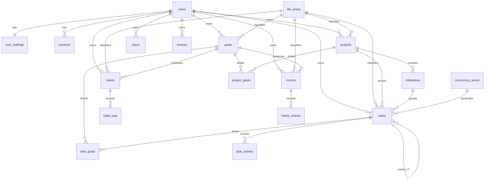
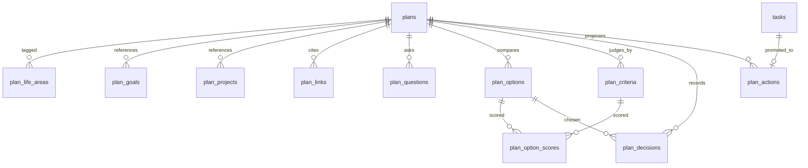

# Data model

Status: planning decision, 27 October 2026. No migration has been created. This document is the schema source of truth. Product rules that explain why a constraint exists are in [01-product-requirements.md](./01-product-requirements.md).

The model is relational and specific. It is not a general "items with types and custom fields" design. Life areas share one task table because a second task table per area would duplicate the same work and split My Day.

## 1. Modeling choices

| Question | Decision |
| --- | --- |
| Who owns rows? | `users`. Reference catalogs (`life_areas`) are global and read-only |
| Are tasks global? | Yes. `life_area_id` is an optional filter, not a separate list |
| Can a task serve several goals? | Yes, through `task_goals`. The task row is not copied |
| Can a task sit in several projects? | No. `tasks.project_id` is a single nullable column. One home keeps My Day and project boards understandable. A task may still link to several goals |
| Where do subtasks live? | On `tasks`, via `parent_task_id`. One level, enforced in the task module and covered by tests |
| How does recurrence avoid duplicates? | A generated row keeps `series_id` and `occurrence_on`. A partial unique index covers that pair |
| How is completion history kept? | `task_activity` is append-only. Reopening does not delete the completed event |
| How do habits vary? | Columns for tracking type and schedule kind, not a subclass table per kind. Logs are separate rows |
| How do measurements vary? | A metric definition plus dated entries. Kind and aggregation are columns. No measurement subclass per life area |
| How do plans stay non-binding? | Plan children never insert into `tasks` until promotion writes both the task and `plan_actions.task_id` |
| What is the calendar? | No event table. The calendar queries `tasks` and `milestones` |
| What is a reminder? | A due date or a scheduled time. No reminder table in the MVP |
| Archive or delete? | Archive for goals, projects, habits, metrics, and plans. Terminal status or hard delete for tasks. Logs and entries survive archive of their parent |

Identifiers are UUIDs generated by PostgreSQL, except `life_areas.id`, which is a stable small integer so seeds and exports stay readable.

Money, quantities, and durations use `numeric(18,4)`. The application treats driver output as strings. It does not round through JavaScript `number`.

## 2. Relationship overview





Cardinality in words:

- A user has one settings row and many sessions.
- A goal has an optional life area. A project has an optional life area.
- A project links to zero or more goals. A goal links to zero or more projects.
- A milestone belongs to exactly one project.
- A task has an optional life area, an optional project, an optional milestone, an optional parent, and an optional series.
- A task links to zero or more goals.
- A series belongs to one user and generates many tasks. A non-recurring task has a null series.
- A habit has an optional area and an optional goal, and has many logs.
- A metric has an optional area and an optional goal, and has many entries. At most one metric is the primary metric for a given goal.
- A plan links optionally to areas, goals, and projects. Those links do not copy the plan into those entities.
- A review belongs to one user and one period start.

Optional on purpose: life area, goal, project, milestone, parent task, series, metric target, goal target date, plan links. Required relationships are ownership (`user_id`) and the internal structure of a plan score (`option_id` plus `criterion_id`).

## 3. Catalogs and identity

### 3.1 `users`

| Column | Type | Notes |
| --- | --- | --- |
| `id` | `uuid` pk | `gen_random_uuid()` |
| `email` | `text` unique not null | Stored lowercase |
| `name` | `text` not null | Display name |
| `password_hash` | `text` not null | Argon2id |
| `created_at` | `timestamptz` not null | |
| `updated_at` | `timestamptz` not null | |

### 3.2 `sessions`

| Column | Type | Notes |
| --- | --- | --- |
| `id` | `uuid` pk | |
| `user_id` | `uuid` not null | fk `users` on delete cascade |
| `token_hash` | `text` unique not null | SHA-256 of the cookie token |
| `expires_at` | `timestamptz` not null | |
| `created_at` | `timestamptz` not null | |
| `last_seen_at` | `timestamptz` not null | |
| `user_agent` | `text` | Optional, for the owner's own session list later |
| `ip_address` | `text` | Optional |

Index: `sessions(user_id)`.

### 3.3 `login_attempts`

| Column | Type | Notes |
| --- | --- | --- |
| `id` | `bigint` pk | identity |
| `email` | `text` not null | |
| `succeeded` | `boolean` not null | |
| `attempted_at` | `timestamptz` not null | default `now()` |
| `ip_address` | `text` | |

Index: `(email, attempted_at desc)`.

### 3.4 `user_settings`

| Column | Type | Notes |
| --- | --- | --- |
| `user_id` | `uuid` pk | fk `users` on delete cascade |
| `timezone` | `text` not null | IANA name. Seed default `Asia/Karachi` |
| `week_starts_on` | `smallint` not null | `0` Sunday through `6` Saturday. Default `1` |
| `currency_code` | `char(3)` not null | Default offered unit. Default `USD` |
| `dashboard_config` | `jsonb` not null | Pins and hidden widgets. Default `{}` |
| `updated_at` | `timestamptz` not null | |

Check: `week_starts_on between 0 and 6`.

`dashboard_config` shape:

```json
{
  "pinnedGoalIds": [],
  "hiddenWidgets": []
}
```

Widget ids are an application enum: `today`, `habits`, `upcoming`, `pinned_goals`, `inbox`. Unknown keys are ignored. This blob is display preference, not a second data model.

### 3.5 `life_areas`

| Column | Type | Notes |
| --- | --- | --- |
| `id` | `smallint` pk | |
| `key` | `text` unique not null | |
| `name` | `text` not null | |
| `purpose` | `text` not null | Short description shown on the area page |
| `sort_order` | `smallint` not null | |

Seeded in a migration:

| id | key | name |
| --- | --- | --- |
| 1 | `business` | Business & Entrepreneurship |
| 2 | `career` | Career & Market-Relevant Skills |
| 3 | `health` | Health & Fitness |
| 4 | `deen` | Deen & Character |
| 5 | `wealth` | Wealth & Financial Independence |
| 6 | `relationships` | Relationships, Family & Home |

No subcategory table in the MVP. A subcategory list would be a second taxonomy before the six areas have been used. Tags can be added later as their own table without rewriting tasks.

## 4. Goals, projects, and milestones

### 4.1 `goals`

| Column | Type | Notes |
| --- | --- | --- |
| `id` | `uuid` pk | |
| `user_id` | `uuid` not null | fk cascade |
| `life_area_id` | `smallint` null | fk `life_areas` |
| `title` | `text` not null | |
| `description` | `text` not null | default `''` |
| `status` | `goal_status` not null | `active`, `paused`, `completed`, `archived`. Default `active` |
| `target_date` | `date` null | |
| `created_at` | `timestamptz` not null | |
| `updated_at` | `timestamptz` not null | |
| `completed_at` | `timestamptz` null | |
| `archived_at` | `timestamptz` null | |

Index: `(user_id, status)`.

The goal does not store a target number. The number lives on the primary metric so there is one place to edit it.

### 4.2 `projects`

| Column | Type | Notes |
| --- | --- | --- |
| `id` | `uuid` pk | |
| `user_id` | `uuid` not null | |
| `life_area_id` | `smallint` null | |
| `title` | `text` not null | |
| `description` | `text` not null | default `''` |
| `status` | `work_status` not null | `active`, `paused`, `completed`, `archived` |
| `start_date` | `date` null | |
| `target_date` | `date` null | |
| `created_at` | `timestamptz` not null | |
| `updated_at` | `timestamptz` not null | |
| `completed_at` | `timestamptz` null | |
| `archived_at` | `timestamptz` null | |

Index: `(user_id, status)`.

### 4.3 `project_goals`

Primary key `(project_id, goal_id)`. Both foreign keys cascade on delete.

Deleting a goal removes the link, not the project. The project module refuses to delete a goal that still has links until the user confirms; the database cascade is the backstop.

### 4.4 `milestones`

| Column | Type | Notes |
| --- | --- | --- |
| `id` | `uuid` pk | |
| `project_id` | `uuid` not null | fk cascade |
| `title` | `text` not null | |
| `target_date` | `date` null | |
| `status` | `milestone_status` not null | `open` or `done` |
| `completed_at` | `timestamptz` null | |
| `sort_order` | `integer` not null | default `0` |

Index: `(project_id, sort_order)`.

## 5. Tasks and recurrence

### 5.1 `recurrence_series`

| Column | Type | Notes |
| --- | --- | --- |
| `id` | `uuid` pk | |
| `user_id` | `uuid` not null | |
| `freq` | `recurrence_freq` not null | `daily`, `weekly`, `monthly` |
| `interval_count` | `integer` not null | default `1`, check `between 1 and 99` |
| `by_weekdays` | `smallint[]` not null | ISO weekday numbers, Monday `1` through Sunday `7`. Default `'{}'` |
| `by_monthday` | `smallint` null | check `between 1 and 31` |
| `starts_on` | `date` not null | |
| `until_on` | `date` null | Inclusive end |
| `is_active` | `boolean` not null | default `true` |
| `title` | `text` not null | Template |
| `notes` | `text` not null | default `''` |
| `priority` | `smallint` not null | `0` none, `1` low, `2` medium, `3` high |
| `estimated_minutes` | `integer` null | check null or `> 0` |
| `life_area_id` | `smallint` null | |
| `project_id` | `uuid` null | `on delete set null` |
| `created_at` | `timestamptz` not null | |
| `updated_at` | `timestamptz` not null | |

Checks:

- `freq = 'weekly'` implies `cardinality(by_weekdays) > 0`.
- `freq = 'monthly'` implies `by_monthday` is not null.
- `freq = 'daily'` implies `by_weekdays` is empty and `by_monthday` is null.
- `until_on` is null or `until_on >= starts_on`.
- Every element of `by_weekdays` is between 1 and 7. Enforced in Zod and by a domain test. PostgreSQL array element checks are optional if they make the migration harder to read; the insert path is the module, not ad hoc SQL.

### 5.2 `series_goals`

Primary key `(series_id, goal_id)`. Both cascade. Copied onto each new occurrence as `task_goals`. Later changes to this set update goal links on open, attached occurrences with `occurrence_on >= today` only.

### 5.3 `tasks`

| Column | Type | Notes |
| --- | --- | --- |
| `id` | `uuid` pk | |
| `user_id` | `uuid` not null | |
| `parent_task_id` | `uuid` null | fk `tasks` on delete cascade |
| `series_id` | `uuid` null | fk `recurrence_series` on delete set null |
| `occurrence_on` | `date` null | Set only for generated rows |
| `detached` | `boolean` not null | default `false` |
| `title` | `text` not null | |
| `notes` | `text` not null | default `''` |
| `status` | `task_status` not null | `inbox`, `todo`, `in_progress`, `done`, `cancelled`. Default `todo` |
| `priority` | `smallint` not null | `0` through `3` |
| `due_on` | `date` null | Deadline, civil date |
| `scheduled_for` | `date` null | The day to do the work |
| `scheduled_start` | `timestamptz` null | Optional clock time |
| `scheduled_end` | `timestamptz` null | |
| `estimated_minutes` | `integer` null | null or `> 0` |
| `life_area_id` | `smallint` null | |
| `project_id` | `uuid` null | on delete set null |
| `milestone_id` | `uuid` null | on delete set null |
| `completed_at` | `timestamptz` null | Last completion instant. History of earlier completions is in `task_activity` |
| `cancelled_at` | `timestamptz` null | |
| `created_at` | `timestamptz` not null | |
| `updated_at` | `timestamptz` not null | |

Checks:

- `priority between 0 and 3`.
- `scheduled_end` is null or (`scheduled_start` is not null and `scheduled_end > scheduled_start`).
- A row is not both a subtask and a series occurrence: `parent_task_id is null or series_id is null`.
- A series occurrence has a date: `series_id is null or occurrence_on is not null`.

Partial unique index `tasks_series_occurrence_uidx` on `(series_id, occurrence_on)` where both are not null.

Other indexes:

- `tasks_user_open_due_idx` on `(user_id, due_on)` where `status in ('inbox', 'todo', 'in_progress')`.
- `tasks_user_scheduled_idx` on `(user_id, scheduled_for)` where status is open, same set.
- `tasks_parent_idx` on `(parent_task_id)`.
- `tasks_project_idx` on `(project_id)` where `project_id is not null`.

Quick capture inserts `status = 'inbox'` and null dates. Scheduling it normally sets `status = 'todo'` when the user assigns a day. The user may also set `in_progress` explicitly.

Open statuses are `inbox`, `todo`, and `in_progress`. Overdue means open and `due_on < today`. Due today means open and `due_on = today`.

### 5.4 `task_goals`

Primary key `(task_id, goal_id)`. Both cascade.

### 5.5 `task_activity`

| Column | Type | Notes |
| --- | --- | --- |
| `id` | `uuid` pk | |
| `task_id` | `uuid` not null | fk cascade |
| `user_id` | `uuid` not null | |
| `event` | `text` not null | `created`, `completed`, `reopened`, `cancelled`, `rescheduled` |
| `from_status` | `task_status` null | |
| `to_status` | `task_status` null | |
| `occurred_at` | `timestamptz` not null | default `now()` |
| `detail` | `jsonb` not null | default `{}`. For reschedule: previous and next `scheduled_for` and `due_on`. No note body |

Index: `(user_id, occurred_at)` and `(task_id, occurred_at)`.

Reviews count `event = 'completed'` inside the period. They do not count a task merely because `completed_at` currently sits in the period, because a reopen updates `completed_at` back to null.

### 5.6 Expansion algorithm

Given a series and an inclusive civil-date window:

- Daily: starting at `starts_on`, step `interval_count` days. Keep dates inside the window and on or before `until_on`.
- Weekly: each date in the window whose ISO weekday is in `by_weekdays`, and whose week distance from the week of `starts_on` is divisible by `interval_count`. The week identity uses the user's `week_starts_on` only for display. The interval uses ISO weeks so the step does not change when the display setting changes. Document this in the series form: "every 2 weeks" means every two ISO weeks.
- Monthly: for each month in the window, the day is `min(by_monthday, last day of that month)`. Keep the date when the month distance from `starts_on` is divisible by `interval_count` and the date is on or after `starts_on`.

Materialized window for reads: from seven days before today through 60 days after today, further clipped by `starts_on` and `until_on`.

Insert is `ON CONFLICT DO NOTHING` against `tasks_series_occurrence_uidx`.

Deactivate:

- Set `is_active = false`.
- Cancel open, `detached = false` occurrences with `occurrence_on >= today`.
- Leave past rows and detached rows alone.

Detach:

- Any user edit to title, notes, priority, estimate, area, project, dates, or goal links on one occurrence sets `detached = true` before the update.
- Completing, reopening, or cancelling does not by itself need to detach. Those rows are already protected because series updates touch only open attached rows. Completion sets status to `done`, so a later template edit will not move them.

Subtasks are never generated by a series.

## 6. Habits

### 6.1 `habits`

| Column | Type | Notes |
| --- | --- | --- |
| `id` | `uuid` pk | |
| `user_id` | `uuid` not null | |
| `life_area_id` | `smallint` null | |
| `goal_id` | `uuid` null | on delete set null |
| `title` | `text` not null | |
| `description` | `text` not null | default `''` |
| `tracking_type` | `habit_tracking` not null | `boolean`, `numeric`, `duration` |
| `unit` | `text` null | Required for numeric and duration |
| `target_value` | `numeric(18,4)` null | Required and `> 0` for numeric and duration. Null for boolean |
| `schedule_kind` | `habit_schedule_kind` not null | `fixed_days` or `weekly_quota` |
| `weekdays` | `smallint[]` not null | ISO 1–7. Used by `fixed_days` |
| `weekly_target` | `integer` null | 1–7, used by `weekly_quota` |
| `status` | `habit_status` not null | `active`, `paused`, `archived` |
| `created_at` | `timestamptz` not null | |
| `updated_at` | `timestamptz` not null | |
| `archived_at` | `timestamptz` null | |

Checks:

- Fixed days: `cardinality(weekdays) > 0` and `weekly_target` is null.
- Weekly quota: `weekly_target between 1 and 7` and `weekdays` is empty.
- Boolean: `target_value` is null and `unit` is null.
- Numeric or duration: `target_value > 0` and `unit` is not null.
- Duration unit is the label shown beside minutes. The stored log value is minutes. The form converts hours and minutes into that number before save.

Index: `(user_id, status)`.

There is no separate `habit_schedules` table. One current schedule is a column set. The accepted MVP limitation is that editing it changes interpretation of days that have no log. Logged, skipped, and rest rows stay as written. A future `effective_from` table can replace these columns without changing `habit_logs`.

### 6.2 `habit_logs`

| Column | Type | Notes |
| --- | --- | --- |
| `id` | `uuid` pk | |
| `habit_id` | `uuid` not null | fk cascade |
| `user_id` | `uuid` not null | Denormalized so a log query does not trust a client habit id alone |
| `logged_on` | `date` not null | Civil date |
| `value` | `numeric(18,4)` null | |
| `log_status` | `habit_log_status` not null | `logged`, `skipped`, `rest` |
| `note` | `text` not null | default `''` |
| `created_at` | `timestamptz` not null | |
| `updated_at` | `timestamptz` not null | |

Unique `(habit_id, logged_on)`.

Checks:

- `logged` requires `value` not null.
- `skipped` and `rest` require `value` null.
- Boolean `logged` stores `value = 1`.

Index: `(user_id, logged_on)`.

### 6.3 How a day is classified

Inputs: the habit's current schedule, the civil date, today, and at most one log.

Fixed days:

| Situation | Class |
| --- | --- |
| Weekday not in `weekdays` and no log | `unscheduled` |
| Log status `logged`, boolean | `met` |
| Log status `logged`, numeric or duration, value `>= target_value` | `met` |
| Log status `logged`, value `< target_value` | `below_target` |
| Log status `skipped` or `rest` | that status, and not a miss |
| Scheduled, no log, date is today | `due` |
| Scheduled, no log, date is before today | `missed` |
| Date after today | `upcoming` if scheduled, otherwise `unscheduled` |

Weekly quota, evaluated per ISO week affected by the user's displayed week only at the boundary of the review period. The quota itself resets on ISO Monday so it does not move when `week_starts_on` changes. The review period can still be Monday–Sunday or Sunday–Saturday for everything else. State this on the habit form if the week start is not Monday: "Times-per-week habits reset on Monday."

| Situation | Class |
| --- | --- |
| Day with a met log | counts toward the quota |
| Day with skipped or rest | does not count toward the quota and is not a miss |
| Day with a below-target log | does not count |
| Before the ISO week ends | the habit is `in_progress` with `metCount / weekly_target`. Individual empty days are not misses |
| After the ISO week ends | the week is `met` when `metCount >= weekly_target`, otherwise `missed`. Empty days stay empty in the history grid |

My Day shows an active weekly-quota habit every day until the quota is met for that ISO week, then hides it until next week. The user can still open the habit and log another day.

## 7. Measurements

### 7.1 `metrics`

| Column | Type | Notes |
| --- | --- | --- |
| `id` | `uuid` pk | |
| `user_id` | `uuid` not null | |
| `life_area_id` | `smallint` null | |
| `goal_id` | `uuid` null | on delete set null |
| `is_primary_for_goal` | `boolean` not null | default `false` |
| `name` | `text` not null | |
| `description` | `text` not null | default `''` |
| `kind` | `metric_kind` not null | `general`, `asset`, `liability`, `income`, `expense` |
| `unit` | `text` not null | Examples: `USD`, `PKR`, `kg`, `km`, `count` |
| `aggregation` | `metric_aggregation` not null | `latest` or `period_sum` |
| `direction` | `metric_direction` not null | `increase`, `decrease`, `maintain` |
| `target_value` | `numeric(18,4)` null | |
| `status` | `text` not null | `active` or `archived` |
| `created_at` | `timestamptz` not null | |
| `updated_at` | `timestamptz` not null | |
| `archived_at` | `timestamptz` null | |

Partial unique index `metrics_one_primary_goal_uidx` on `(goal_id)` where `is_primary_for_goal` and `goal_id` is not null.

Suggested pairings, not constraints: balances use `latest`; income and expense amounts use `period_sum`. A savings balance is `asset` + `latest`. A monthly spending total the user types once per month is `expense` + `period_sum`. The user can override the pairing if they know what they are recording.

Index: `(user_id, status)`.

### 7.2 `metric_entries`

| Column | Type | Notes |
| --- | --- | --- |
| `id` | `uuid` pk | |
| `metric_id` | `uuid` not null | fk cascade |
| `user_id` | `uuid` not null | |
| `recorded_on` | `date` not null | |
| `value` | `numeric(18,4)` not null | |
| `note` | `text` not null | default `''` |
| `created_at` | `timestamptz` not null | |
| `updated_at` | `timestamptz` not null | |

Unique `(metric_id, recorded_on)`.

Index: `(metric_id, recorded_on desc)`.

### 7.3 Derived values

Current value of a `latest` metric: the entry with the greatest `recorded_on` that is on or before today. A future-dated entry does not become current early.

Period sum: the sum of `value` for entries with `recorded_on` inside the inclusive range. Sum in SQL.

Goal progress, only when a primary metric exists and has a target and at least one current value:

- Direction `increase`: compare current to target. Display the raw values and a percentage capped in the interface at 100 for the bar, while the text can show over-target.
- Direction `decrease`: progress reflects movement down toward the target. If the target is zero, show the values without a percentage.
- Direction `maintain`: show current, target, and the gap. No percentage bar.

If any required piece is missing, show "No measurement yet" or the status and date. Do not invent zero.

Net worth:

- Consider active or archived metrics of kind `asset` and `liability` that have a current `latest` value. `period_sum` metrics are excluded from net worth.
- If the included values do not all share one unit, do not compute a total. Group by unit instead.
- If there is no asset or there is no liability, do not compute a total. List the side that exists. Absence of a liability metric is not treated as zero debt.
- When both sides exist and the unit matches, net worth is the sum of asset current values minus the sum of liability current values, calculated in SQL.

Area cash flow for the current calendar month:

- Compute income minus expense only when the area has exactly one active `income` metric and exactly one active `expense` metric, they share a unit, and both use `period_sum`.
- Otherwise list each metric's own month sum or current value.

No row stores net worth or profit. They are queries. A completed review may copy the number into its snapshot.

## 8. Planning

### 8.1 `plans`

| Column | Type | Notes |
| --- | --- | --- |
| `id` | `uuid` pk | |
| `user_id` | `uuid` not null | |
| `title` | `text` not null | |
| `status` | `plan_status` not null | `idea`, `exploring`, `decided`, `active`, `completed`, `archived`. Default `idea` |
| `summary` | `text` not null | default `''` |
| `body_markdown` | `text` not null | default `''` |
| `created_at` | `timestamptz` not null | |
| `updated_at` | `timestamptz` not null | |
| `decided_at` | `timestamptz` null | Set when status first becomes `decided` |
| `completed_at` | `timestamptz` null | |
| `archived_at` | `timestamptz` null | |

Index: `(user_id, status)`.

Allowed transitions are enforced in the planning module, not by a database trigger. Any status may move to `archived`. `archived` may return to `exploring`. Forward and backward moves among the other five are allowed so the user can correct a label. None of those moves insert tasks.

### 8.2 Link tables

- `plan_life_areas` primary key `(plan_id, life_area_id)`.
- `plan_goals` primary key `(plan_id, goal_id)`.
- `plan_projects` primary key `(plan_id, project_id)`.

All foreign keys cascade from the plan and cascade from the linked record. Removing a goal drops the plan's reference and leaves the plan.

### 8.3 `plan_links`

`id`, `plan_id`, `url`, `title` default `''`, `note` default `''`, `created_at`. The URL is stored as text after Zod checks that it is an `http` or `https` URL. Rendering treats it as an external link with `rel="noreferrer"`.

### 8.4 `plan_questions`

`id`, `plan_id`, `question`, `status` of `open`, `answered`, or `dropped`, `answer` default `''`, `sort_order`.

### 8.5 `plan_options`

`id`, `plan_id`, `name`, `description` default `''`, `is_chosen` default `false`, `sort_order`.

Partial unique index on `(plan_id)` where `is_chosen`. Choosing an option clears the previous chosen flag in the same transaction.

### 8.6 `plan_criteria`

`id`, `plan_id`, `name`, `sort_order`. No weight column in the MVP.

### 8.7 `plan_option_scores`

Primary key `(option_id, criterion_id)`. `score` is a `smallint` null or between 1 and 5. `note` default `''`.

The displayed total for an option is the arithmetic mean of its non-null scores. Options with no scores show "Unscored". The mean is not stored. A null score is "not judged", not zero.

### 8.8 `plan_decisions`

| Column | Type | Notes |
| --- | --- | --- |
| `id` | `uuid` pk | |
| `plan_id` | `uuid` not null | fk cascade |
| `title` | `text` not null | |
| `rationale_markdown` | `text` not null | default `''` |
| `decided_on` | `date` not null | |
| `chosen_option_id` | `uuid` null | on delete set null |
| `created_at` | `timestamptz` not null | |

A plan may have several decision rows. The newest is the current one. Older rows remain so a changed mind has a trail.

### 8.9 `plan_actions`

| Column | Type | Notes |
| --- | --- | --- |
| `id` | `uuid` pk | |
| `plan_id` | `uuid` not null | |
| `title` | `text` not null | |
| `notes` | `text` not null | default `''` |
| `due_on` | `date` null | Copied onto the task if promoted |
| `status` | `text` not null | `proposed`, `accepted`, `dismissed`, `done` |
| `task_id` | `uuid` unique null | fk `tasks` on delete set null |
| `created_at` | `timestamptz` not null | |

Promotion, in one transaction:

1. Insert a task with the action title, notes, and due date, status `todo`, and the plan's first life area if it has exactly one. Do not guess an area when the plan has several.
2. Set the action to `accepted` and store `task_id`.
3. Do not mark the task done when the action is later marked done, and do not mark the action done when the task is completed. The user may connect them later if they want that coupling. The MVP keeps the link visible and lets each status move on its own. This avoids a hidden automation.

Dismissed actions stay on the plan and create nothing.

## 9. Reviews

### 9.1 `reviews`

| Column | Type | Notes |
| --- | --- | --- |
| `id` | `uuid` pk | |
| `user_id` | `uuid` not null | |
| `period` | `review_period` not null | `weekly` or `monthly` |
| `period_start` | `date` not null | |
| `period_end` | `date` not null | |
| `stats` | `jsonb` not null | default `{}` |
| `stats_generated_at` | `timestamptz` null | |
| `went_well` | `text` not null | default `''` |
| `incomplete_priorities` | `text` not null | default `''` |
| `obstacles` | `text` not null | default `''` |
| `lessons` | `text` not null | default `''` |
| `priority_changes` | `text` not null | default `''` |
| `next_actions` | `text` not null | default `''` |
| `status` | `review_status` not null | `draft` or `completed` |
| `created_at` | `timestamptz` not null | |
| `updated_at` | `timestamptz` not null | |
| `completed_at` | `timestamptz` null | |

Unique `(user_id, period, period_start)`. Check `period_end >= period_start`.

Weekly bounds are computed from `week_starts_on` in the user timezone. Monthly bounds are the first and last civil dates of the calendar month in that timezone.

`stats` shape, versioned by a `version` field starting at `1`:

```json
{
  "version": 1,
  "tasksCompleted": [{ "id": "uuid", "title": "string", "completedAt": "iso" }],
  "tasksStillOverdue": [{ "id": "uuid", "title": "string", "dueOn": "date" }],
  "habits": [
    {
      "id": "uuid",
      "title": "string",
      "met": 0,
      "belowTarget": 0,
      "missed": 0,
      "skipped": 0,
      "rest": 0
    }
  ],
  "metricDeltas": [
    {
      "id": "uuid",
      "name": "string",
      "unit": "string",
      "startValue": "string",
      "endValue": "string"
    }
  ],
  "goalsCompleted": [{ "id": "uuid", "title": "string" }]
}
```

Titles are copied in so a later rename does not rewrite history. Refresh on a draft replaces `stats` and `stats_generated_at`. Completed reviews ignore refresh.

Metric delta uses, for `latest`, the last entry on or before `period_start` and the last entry on or before `period_end`. For `period_sum`, both numbers are sums inside the period and the previous equal-length period. If a side is missing, store null and let the screen say "no entry".

## 10. Example records

These illustrate shape. They are not seed data. The application starts with life areas, one user, and empty domain tables.

### 10.1 A task scheduled before its deadline

```json
{
  "title": "Draft the agency homepage outline",
  "status": "todo",
  "priority": 2,
  "scheduled_for": "2026-10-28",
  "due_on": "2026-10-31",
  "life_area_id": 1,
  "project_id": "project-website",
  "goal_ids": ["goal-first-retainer"]
}
```

My Day on 28 October shows it under scheduled. My Day on 31 October shows it under due if it is still open. It was not copied into a second list.

### 10.2 A monthly series and one cancelled occurrence

Series: `freq = monthly`, `interval_count = 1`, `by_monthday = 31`, `starts_on = 2026-01-31`, title "Review business expenses".

Generated `occurrence_on` values include `2026-02-28`, `2026-04-30`, and `2026-10-31`. February uses the clamp rule.

The October row can be cancelled. The unique key remains, so the next page load does not recreate October. November is a different `occurrence_on` and may be created when the window reaches it.

### 10.3 Two habits

```json
[
  {
    "title": "Walk",
    "tracking_type": "numeric",
    "unit": "km",
    "target_value": "5.0000",
    "schedule_kind": "fixed_days",
    "weekdays": [1, 2, 3, 4, 5, 6, 7]
  },
  {
    "title": "Fajr on time",
    "tracking_type": "boolean",
    "schedule_kind": "fixed_days",
    "weekdays": [1, 2, 3, 4, 5, 6, 7]
  }
]
```

A walk log of `4` on a date is `below_target`. A fajr log of status `logged` and value `1` is `met`. A rest log on a travel day is neutral. Neither habit produces a score outside its own history.

### 10.4 Wealth snapshots that must not be added

```json
[
  { "name": "Cash savings", "kind": "asset", "aggregation": "latest", "unit": "PKR" },
  { "name": "Brokerage account", "kind": "asset", "aggregation": "latest", "unit": "USD" },
  { "name": "Credit card", "kind": "liability", "aggregation": "latest", "unit": "PKR" }
]
```

The screen may total PKR cash minus the PKR card only if the rule in section 7.3 is satisfied for a single unit group. It does not convert USD. It does not assume a return on the brokerage account.

### 10.5 A plan that has not become work

A plan titled "Move abroad for a stronger engineering role", status `exploring`, linked to life areas `career`, `wealth`, `relationships`, and `deen`.

Two options, "Stay" and "Relocate", scored against criteria the user writes, such as income, family support, and ability to keep a practice. A decision row records the rationale. `plan_actions` contains "Price a three-month runway" in status `proposed` with a null `task_id`. The task table has no row from this plan until promotion.

## 11. Timestamps, dates, and time zones

| Kind of fact | Column type | Authority |
| --- | --- | --- |
| When a row was written or a task was completed | `timestamptz` | Server clock, stored in UTC, shown in the user zone |
| A deadline, a scheduled day, a habit day, a measurement day, a review boundary | `date` | Civil date the user meant. Not derived by truncating a UTC timestamp |
| A clock time on a task | `timestamptz` | The instant corresponding to the wall time the user picked in their zone |
| Today | computed | `user_settings.timezone` at request time |

Writing a `date` from the browser sends `YYYY-MM-DD`, not an instant. The server does not run that string through `new Date(string)`, which parses date-only strings as UTC and can shift the day.

Display of a `timestamptz` uses the user zone. Display of a `date` prints the date as stored.

## 12. Deletion, archive, and history

| Record | Default remove | Hard delete |
| --- | --- | --- |
| Goal, project, habit, metric, plan | Set status archived and the archived timestamp | Confirmation names child history that will cascade |
| Milestone | Delete the milestone row after confirmation | Tasks keep their other fields; `milestone_id` becomes null |
| Task | Cancel, which keeps the row | Delete cascades activity, task-goal links, and nulls `plan_actions.task_id` |
| Series | Deactivate | Delete removes the template. Occurrence tasks keep their rows and lose `series_id` because of `on delete set null`, which would allow a later bug to regenerate them if the series id disappeared. Prefer deactivate. Hard delete of a series is not in the MVP interface |
| Habit log or metric entry | Edit or replace the day | Delete that day only |
| Review | None in the MVP once completed | A draft may be discarded. A completed review is part of the history |
| Session | Logout | Delete the row |
| User | Not exposed | Dropping the database is an operator action |

Archiving a habit or metric does not delete logs or entries. Active screens filter `status = 'active'` for habits and metrics, and `status = 'active'` for goals and projects. A history toggle shows paused and archived parents.

Task lists default to open statuses. Completed and cancelled views are explicit.

Export includes archived rows and excludes `password_hash`, `sessions`, and `login_attempts`.

## 13. Indexes and constraints that protect the product

These are load-bearing. Tests should fail if a migration drops them.

| Constraint | Failure it prevents |
| --- | --- |
| `tasks_series_occurrence_uidx` | Duplicate recurring tasks |
| `habit_logs (habit_id, logged_on)` | Two outcomes for one habit day |
| `metric_entries (metric_id, recorded_on)` | Two balances for one day |
| `metrics_one_primary_goal_uidx` | Two primary progress numbers for one goal |
| `plan_options` one chosen per plan | Two selected futures |
| `reviews (user_id, period, period_start)` | Two conflicting weekly write-ups |
| `sessions.token_hash` unique | Two rows for one cookie |
| Task status and schedule indexes | A slow or sequentially scanned My Day after a few years of completed rows |

## 14. Migration strategy

- Drizzle schema in `src/db/schema.ts` is edited first. `drizzle-kit generate` writes SQL into `drizzle/`. Generated SQL is reviewed before it is committed. Migrations apply through `DIRECT_URL` on Supabase.
- Life-area inserts live in a migration so tests and production cannot boot without them.
- The owner user is not in a migration. The seed command creates the user and the settings row from the environment.
- Migrations run before the server accepts traffic.
- Changes are forward-only.
- A destructive change to a populated column is split into expand, backfill, switch reads, then drop.
- The app schema is `public` in the single Supabase database. The test suite applies the same migration chain with `search_path` set to `app_test` and exits if it is about to truncate or delete inside `public`.
- New tables enable row level security and do not grant privileges to `anon` or `authenticated`.
- `gen_random_uuid()` is available on the Postgres versions Supabase runs. A migration may still `CREATE EXTENSION IF NOT EXISTS pgcrypto` so the UUID default is explicit.

Initial migration order inside the first schema milestone:

1. `pgcrypto` if `gen_random_uuid` is not already available, plus `ENABLE ROW LEVEL SECURITY` on each new application table.
2. Enums.
3. `users`, `sessions`, `login_attempts`, `user_settings`.
4. `life_areas` and seed.
5. Domain tables in dependency order: goals, projects, project goals, milestones, series, tasks, link tables, habits, metrics, plans, reviews.

Later phases may add their tables in their own migrations instead of one giant first migration. The roadmap says which phase creates which tables. Either sequencing is valid if the chain from an empty database reaches this document's shape. Prefer one migration per phase so a half-built environment stays coherent.

## 15. What is deliberately not a table

| Candidate | MVP decision |
| --- | --- |
| Subcategories and tags | Later, as a real table, when an area is too coarse in practice |
| Calendar events and reminders | Views and dates on tasks and milestones |
| Notifications | No stored subscription until push exists |
| Habit schedule versions | Columns on `habits` |
| Net worth and life score | Queries, and the score does not exist at all |
| Contacts, leads, invoices, accounts in the ledger sense | Out of product scope |
| Attachments | Out of scope |
| Custom fields | Out of scope |
| AI conversations | Out of scope |
