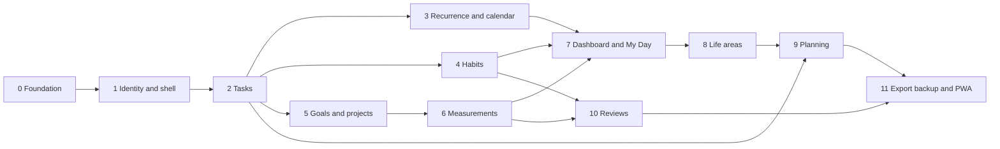

# Implementation roadmap

Status: planning decision, 27 October 2026. Do not start these phases until the planning set has been reviewed. Do not skip ahead of a dependency. Task-level status lives only in [07-task-backlog.md](./07-task-backlog.md).

## 1. Critical path

The path that gates daily use is 0 → 1 → 2 → 4, with a thin My Day available as soon as tasks exist and a real My Day once habits exist. Recurrence is recommended immediately after tasks, while that code is still fresh, and it is not a functional dependency of habits. Goals and measurements deepen the loop. Planning and reviews are the direction loop and come after there is something dependable to attach them to. Export, the PWA shell, and the restore drill come last so they cover the finished schema.

Why this order:

- Auth and `user_id` come before domain tables so ownership is never retrofitted.
- The task row comes before recurrence, because an occurrence is a task.
- The calendar comes after recurrence, because it is a view and should be built once dated rows exist.
- Habits come before the polished My Day, because a My Day without habits would teach the wrong daily workflow and then have to be redesigned.
- Goals come after tasks so linking is a foreign key onto something real, and so the product does not force a goal into the first captured task.
- Measurements come after goals so the primary-metric link has a parent.
- Life-area pages come after the entities they count. The area catalog itself is seeded in phase 1 so tasks can store `life_area_id` early.
- Planning comes after tasks so "create task" has one implementation. It does not come before the daily loop, because a planning tool that cannot survive Tuesday is a miss on the vision.
- Reviews come after tasks, habits, metrics, and goals, because the snapshot is defined in terms of those records.
- The service worker comes last so it is written against the real routes and is tested not to cache them.

Phases are not feature flags inside a big bang. Each phase leaves the application buildable, migratable, and usable for what it has already shipped.

## 2. Shared definition of done

A phase is done when all of the following are true:

- Its backlog tasks are marked `done` in document 07.
- Its migrations apply to an empty database and to a database that already has the previous phase.
- Its automated tests pass.
- New mutations call `requireUser()` and filter by that user.
- The new screens were exercised at phone width and desktop width, including the empty and the failure path named in the phase.
- No secret, dump, or `.env` file was committed.
- The phase did not add a queue, a second service, or a client state library.

## 3. Phase 0 — Foundation

Objective: a Next.js toolchain that boots, migrates against Supabase, and runs an empty test, with no product behavior.

Features: repository, TypeScript, lint, test runner, Supabase connection settings, Drizzle, logging, security-header placeholder.

Dependencies: planning review. No application code exists today. The owner creates one Supabase project before `LT-002` can be checked off.

Likely files:

- `package.json`, `tsconfig.json`, `next.config.ts`, `eslint` config
- `.env.example`, `.gitignore`
- `src/db/client.ts`, `src/db/migrate.ts`, `src/db/schema.ts`
- `src/lib/logger.ts`
- `drizzle/`
- `vitest.config.ts`

Database changes: none beyond the tool being able to connect. The first tables arrive in phase 1. No local Postgres container is added.

Tests: Vitest runs one passing unit test. A connectivity test selects `1` from the Supabase database.

Acceptance: the app compiles and connects to the single Supabase project with TLS. `npm test` runs. Node engine is 24. Authenticated caching is documented in `next.config` or a short comment next to the future app layout so phase 1 does not "discover" static rendering. The Data API is off, and the app env does not contain an anon key or a service-role key.

Definition of done: the shared definition, plus a README at the repo root that points to `docs/` and does not claim features that are not built.

Risks: scaffolding the wrong Next.js major, adopting Drizzle 1.0 RC, or letting tests truncate `public`. Mitigation: pin Next.js 16.4 latest patch and Drizzle 0.45 as specified in the architecture document, and make the test harness abort unless the current schema is `app_test`. The local Node 23 binary is not the runtime. A free project can pause after a quiet week. The project should be on a paid plan if that pause is unacceptable.

Backlog: `LT-001` through `LT-005`.

## 4. Phase 1 — Identity, shell, and life areas

Objective: the owner can sign in on a phone-sized viewport and a desktop viewport, set a timezone, and see an empty authenticated shell. Nobody else can sign up.

Features: user, session, settings, login, sign out, password change, rate limit, sidebar and bottom navigation, seeded life areas, placeholder My Day.

Dependencies: phase 0.

Likely files:

- `src/db/schema.ts` additions and a migration
- `src/modules/auth/*`
- `src/modules/settings/*`
- `src/modules/life-areas/*`
- `src/app/(public)/login/page.tsx`
- `src/app/(app)/layout.tsx`
- `src/app/(app)/today/page.tsx`
- `src/components/shell/*`
- `scripts/seed.ts`

Database changes: `users`, `sessions`, `login_attempts`, `user_settings`, `life_areas` and the six seed rows.

Tests: wrong password, lockout threshold, expired session, missing cookie, password change, life-area seed present. Two-user fixture started here even though domain rows come later.

Acceptance: there is no registration control. Login failure text does not reveal whether the email exists. Settings persist timezone, week start, and currency. Shell matches the navigation in the UX document, including the phone bottom bar.

Definition of done: shared definition. Seed password is read from the environment and is not in source.

Risks: trusting middleware alone. Mitigation: the placeholder loader calls `requireUser()`, and a test requests it without a cookie.

Backlog: `LT-006` through `LT-011`.

## 5. Phase 2 — Tasks

Objective: a trustworthy global task list with capture, scheduling, deadlines, completion history, and one-level subtasks.

Features: task CRUD, statuses, priorities, both dates, optional time, cancel, reopen, reschedule, activity rows, list views, quick capture.

Dependencies: phase 1, because of `user_id` and life areas.

Likely files:

- `src/modules/tasks/schema.ts`, `queries.ts`, `actions.ts`, `activity.ts`
- `src/app/(app)/tasks/page.tsx`
- `src/app/(app)/tasks/[id]/page.tsx`
- task form components

Database changes: `tasks` and `task_activity` only. `task_goals`, `project_id`, and `milestone_id` are added in phase 5. Phase 2 does not show a goal or project picker.

Tests: create and complete, reopen preserves a completed activity row, reschedule records previous dates, subtask depth rejected, parent completion leaves children open, another user cannot load the task, quick capture stays out of today's scheduled group.

Acceptance: the stories for capture, scheduled-versus-due, and completion history in the product requirements pass. Inbox, upcoming, overdue, and completed views exist. `/today` already groups scheduled, due-today, and overdue tasks so the daily loop does not wait for the later dashboard phase. Estimate totals, the inbox count line, and dashboard widgets are phase 7.

Definition of done: shared definition, plus a manual pass of create, complete, and reschedule at 390px and 1280px.

Risks: collapsing scheduled date and due date into one field. Mitigation: the form and the tests use both columns.

Backlog: `LT-012` through `LT-016`.

## 6. Phase 3 — Recurrence and calendar

Objective: repeating work materializes once per date, and dated work is visible on a calendar.

Features: daily, weekly, and monthly rules; generate on read; detach; deactivate; week agenda; month grid.

Dependencies: phase 2.

Likely files:

- `src/modules/tasks/recurrence.ts` and `recurrence.test.ts`
- `src/modules/tasks/materialize.ts`
- `src/app/(app)/calendar/page.tsx`

Database changes: `recurrence_series`, `series_goals` (the goal copy can wait for phase 5 if the insert copies no goals yet), unique index `tasks_series_occurrence_uidx`, task columns `series_id`, `occurrence_on`, `detached`.

Tests: the expansion cases in the data model, including 31 January monthly through February, every second ISO week, double materialize producing one row, cancel blocking regeneration, template edit skipping detached and completed rows, deactivate cancelling future attached open rows.

Acceptance: opening Tasks twice does not duplicate. The calendar is a view: creating from a day inserts a task, not an event row.

Definition of done: shared definition. No cron process was added.

Risks: timezone bugs from `new Date('YYYY-MM-DD')`. Mitigation: date helpers and tests around a zone ahead of UTC and a zone behind UTC. Asia/Karachi is one of them.

Backlog: `LT-017` through `LT-021`.

## 7. Phase 4 — Habits

Objective: My Day can track boolean, numeric, and duration habits without calling an unscheduled day a failure.

Features: habit definition, both schedule kinds, logs, skip, rest, history, pause, archive, My Day habit region.

Dependencies: phase 2, so My Day can show habits beside tasks. The habit tables themselves need only phase 1. Recurrence is not a dependency. The optional `goal_id` column can be nullable now and unused by the form until phase 5.

Likely files:

- `src/modules/habits/*`
- `src/app/(app)/habits/page.tsx`
- `src/app/(app)/habits/[id]/page.tsx`
- My Day habit section

Database changes: `habits`, `habit_logs`, checks and the unique day index.

Tests: classification table from the data model, weekly quota before and after the week ends, pause, unique log upsert, below-target numeric log, boolean log.

Acceptance: story 6 in the product requirements. My Day hides unscheduled habits and hides a satisfied weekly quota.

Definition of done: shared definition. This is the first daily-use milestone together with phase 2.

Risks: storing duration as hours in one place and minutes in another. Mitigation: the column is minutes, and the test asserts a 1 hour 30 minute entry stores `90`.

Backlog: `LT-022` through `LT-026`.

## 8. Phase 5 — Goals and projects

Objective: outcomes and efforts can be linked to tasks without becoming mandatory.

Features: goals, projects, milestones, project-goal links, task project and goal links, goal page without a fake percentage.

Dependencies: phase 2. Measurements are not required for this phase. A goal with no metric shows status and date only. Primary metric selection lands in phase 6.

Likely files:

- `src/modules/goals/*`
- `src/app/(app)/goals/page.tsx`
- `src/app/(app)/goals/[id]/page.tsx`
- `src/app/(app)/projects/page.tsx`
- `src/app/(app)/projects/[id]/page.tsx`
- task form additions

Database changes: `goals`, `projects`, `project_goals`, `milestones`, `task_goals`, `series_goals`, plus nullable `tasks.project_id` and `tasks.milestone_id`.

Tests: task with no goal saves, project links to two goals, one-level milestone list, archiving a goal leaves tasks, deleting a milestone nulls `milestone_id`.

Acceptance: story 7. Project detail shows tasks grouped by milestone.

Definition of done: shared definition.

Risks: requiring a goal in the task form because the column exists. Mitigation: an explicit test inserts a task with null area, project, and goals.

Backlog: `LT-027` through `LT-031`.

## 9. Phase 6 — Measurements

Objective: manual numeric history, with net worth and profit only when the records are honest.

Features: metric CRUD, one entry per day, history table and chart, primary metric on a goal, net worth and area cash-flow rules.

Dependencies: phase 5 for the goal link. The metric tables themselves need only phase 1, but the primary-metric UI should ship with goals.

Likely files:

- `src/modules/measurements/*`
- `src/lib/decimal.ts`
- `src/app/(app)/measurements/page.tsx`
- `src/app/(app)/measurements/[id]/page.tsx`

Database changes: `metrics`, `metric_entries`, partial unique index for one primary metric per goal.

Tests: upsert same date, `latest` ignores a future date, `period_sum`, mixed units do not total, missing liability does not become zero, two primary metrics for one goal violate the index, values round-trip as numeric strings including `0.1000` and a large balance.

Acceptance: story 8. Goal detail shows a bar only when the data-model rule allows it.

Definition of done: shared definition.

Risks: floating-point money. Mitigation: `numeric` and string handling, with tests that would fail on `0.1 + 0.2` style errors if someone sums in JavaScript.

Backlog: `LT-032` through `LT-035`.

## 10. Phase 7 — Dashboard and My Day

Objective: the two home screens match the product requirements now that the underlying records exist.

Features: estimated-minute line and inbox count on My Day; no duplicate task between the scheduled and due groups; dashboard widgets; pins and hidden widgets; seven-day upcoming list. Habit and task groups already exist from phases 4 and 2.

Dependencies: phases 2, 4, 5, and 6.

Likely files:

- `src/modules/dashboard/*`
- `src/app/(app)/today/page.tsx`
- `src/app/(app)/page.tsx`
- settings widget form

Database changes: none. `dashboard_config` already exists. This phase starts writing its documented JSON shape.

Tests: a task scheduled today and due later appears only in the scheduled group; an overdue task appears in overdue; a pinned goal without a metric has no percentage; a hidden widget is absent; inbox count excludes inbox items from the body of My Day.

Acceptance: dashboard and My Day sections in the UX document.

Definition of done: shared definition, including a pass on a 390px viewport where the bottom bar does not cover capture.

Risks: N+1 queries making the page chatty. Mitigation: one query per group or a small fixed set, checked once with a SQL log. No cache layer.

Backlog: `LT-036` through `LT-038`.

## 11. Phase 8 — Life area pages

Objective: each area is a filtered front door, not a new data silo.

Features: area index with counts, area detail sections, suggestion buttons that create normal rows only after a click, cash-flow line when the rule matches.

Dependencies: phase 7, so the entities and the home screens already agree.

Likely files:

- `src/modules/life-areas/suggestions.ts`
- `src/app/(app)/areas/page.tsx`
- `src/app/(app)/areas/[key]/page.tsx`

Database changes: none.

Tests: suggestion click creates one habit or metric; merely opening the page creates nothing; area task list is a filter on the global table; unknown key returns not available.

Acceptance: the six empty states in the UX document, including the deen and wealth sentences.

Definition of done: shared definition.

Risks: wording that scores faith or promises returns. Mitigation: copy is fixed in the suggestions module and glanced at in review of the phase. No algorithmic score is computed.

Backlog: `LT-039` and `LT-040`.

## 12. Phase 9 — Planning

Objective: the user can think in a plan and create a task only by an explicit action.

Features: plan CRUD, statuses, Markdown, area and record links, questions, reference links, comparison grid, decisions, promote, dismiss, archive.

Dependencies: phases 2 and 8. Life-area links need the catalog from phase 1; the area detail "add plan" button needs phase 8. Goal and project links need phase 5, which is already on the path.

Likely files:

- `src/modules/planning/*`
- `src/app/(app)/plans/page.tsx`
- `src/app/(app)/plans/[id]/page.tsx`
- `src/app/(app)/plans/[id]/compare/page.tsx`

Database changes: the planning tables from the data model.

Tests: new idea creates zero tasks; promote creates exactly one and is idempotent if clicked again; archive does not delete that task; a second chosen option clears the first; mean ignores blanks; highest mean does not set `is_chosen`; Markdown raw HTML is not rendered as HTML.

Acceptance: story 9 and the planning sections of the UX document.

Definition of done: shared definition.

Risks: a convenient "generate tasks from the plan" control. Mitigation: the only create-task control is per action, and the test above is required.

Backlog: `LT-041` through `LT-045`.

## 13. Phase 10 — Reviews

Objective: a weekly and a monthly review grounded in stored records, with a snapshot that stays still after completion.

Features: create draft, generate stats, reflection fields, refresh, complete, list past reviews.

Dependencies: phases 4, 5, 6, and the task activity from phase 2. Planning is not a dependency.

Likely files:

- `src/modules/reviews/*`
- `src/app/(app)/reviews/page.tsx`
- `src/app/(app)/reviews/[id]/page.tsx`

Database changes: `reviews` and the unique period index.

Tests: week bounds honor `week_starts_on` and a non-UTC zone; month bounds are calendar months in that zone; completed-task count uses activity events; completing a review then deleting a task leaves the snapshot; refresh works on a draft and not on a completed review; a second insert for the same week hits the unique constraint and the UI reopens the existing draft.

Acceptance: story 10.

Definition of done: shared definition.

Risks: generating stats on every render of a completed review and overwriting the snapshot. Mitigation: the loader uses stored `stats` when status is `completed`.

Backlog: `LT-046` through `LT-048`.

## 14. Phase 11 — Export, PWA shell, backup, and hardening

Objective: the owner can leave with their data, reinstall from a backup, and install the app on a phone without caching private pages.

Features: JSON export, three CSV exports, manifest, service worker, offline page, production run of the Next.js process, health check, migrate-on-start, backup and restore runbook, restore drill, Playwright path, authorization sweep.

Dependencies: phases 9 and 10, so the export includes plans and reviews.

Likely files:

- `src/modules/export/*`
- `src/app/offline/page.tsx`
- `src/app/health/route.ts`
- `public/manifest.webmanifest`, icons
- service worker configuration
- `docs/operations/backup-and-restore.md`
- `Dockerfile` for the Next.js process, with no database service
- `tests/e2e/daily.spec.ts`

Database changes: none expected.

Tests: export requires auth and contains no `password_hash` or session token; service worker config does not list document or action caching; restore drill from a dump into schema `restore_drill` returns the same task count and leaves `public` in place; Playwright signs in, captures, completes, logs a habit, and creates a plan with zero new tasks.

Acceptance: story 11, the offline page, and a written restore that the owner can run.

Definition of done: shared definition. The MVP feature list in the product requirements is present. Implementation stops for another review. No follow-on phase starts automatically.

Risks: a service worker that precaches authenticated routes. Mitigation: a test or a build assertion on the worker config, and a manual check in a browser that `/today` is not available offline. Browser verification is required for this phase because it is user-visible installation and offline behavior.

Backlog: `LT-049` through `LT-054`.

## 15. After the MVP

Post-MVP work is not sequenced here on purpose. The product requirements list the candidates. The next plan should be written after at least a few weeks of real use, because reminder delivery, offline sync, and finance pages are easy to overbuild from imagination.

If a security issue forces work during the MVP, it jumps the queue. Feature work does not.

## 16. Suggested first implementation session

When implementation is approved, start at `LT-001` and stop at the end of phase 1 for a checkpoint if the owner wants to see login before tasks. Otherwise continue through phase 4, which is the first meaningful daily-use slice. Do not begin planning documents again unless a phase discovers a contradiction. If that happens, update the affected document in the same change and record the reason in the backlog task.
